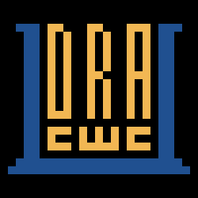
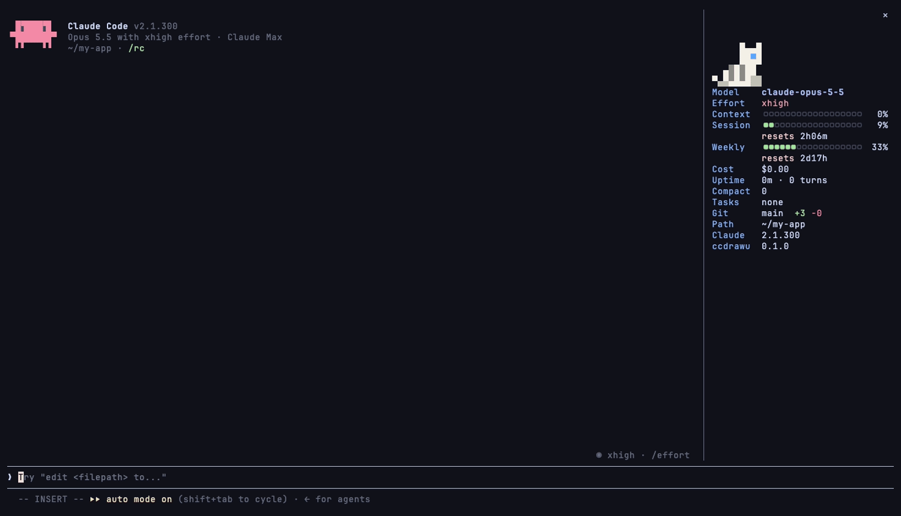

# ccdrawu

<p align="center"></p>

[](https://github.com/vulcanshen/ccdrawu/releases)
[](https://go.dev/)
[](LICENSE)

**語言**：[English](README.md) · 繁體中文

**Claude Code 的側邊欄與狀態列。** 用量上限、context、模型、花費、git 和 session 統計都放在對話旁邊的面板裡，不再擠在輸入框下方。想放在輸入框下方的話，也可以當成 Claude Code 的狀態列，照你挑的方式排。



## 顯示的內容

| 列 | 內容 |
|---|---|
| Pet | 陪著你的像素寵物，見[寵物](#寵物) |
| Model、Effort | 這個 session 的模型，以及上一次請求的 effort 等級：`low` 綠色，一路到 `max` 紅色 |
| Mode | 權限模式：`auto`、`plan`、`accept edits`… |
| Context、Session、Weekly | context 用量，以及方案的 5 小時和每週用量與重置倒數。bar 在 50%、70%、90% 分別從綠變黃、橘、紅 |
| Spend | 透過有消費上限的 gateway 使用時：用了多少、什麼時候重置 |
| Cost | 這個 session 到目前為止的花費 |
| Uptime | session 開了多久、你送出了幾則訊息 |
| Cache | 上一次請求有多少是從 prompt cache 讀的 |
| Compact | 對話被壓縮過幾次 |
| Tasks | 正在跑的 subagent，以及 Claude 上一次回覆結束時還在背景跑的 shell、monitor、workflow，各種類分別計數：`2 agents｜1 shell` |
| Git、Path | branch 和增減行數、工作目錄 |
| Claude、ccdrawu | 你的 Claude Code 版本（有新版時一併顯示），以及這個側邊欄自己的版本 |

下面這些預設是關的，到 `ccdrawu` 裡打開：

| 列 | 內容 |
|---|---|
| Style | `/config` 裡設的 output style |
| ID、Account | 這個 session 的 id 開頭，以及登入的 Claude 帳號 |
| Window | context 用了多少 token、視窗多大：`420k / 1M` |
| Rate | 這個 session 到目前為止，平均每小時花多少 |
| Tokens、Speed | 側邊欄載入後，對話累計的 input、output、cache token，以及上一次回覆每秒輸出幾個 token |
| Skills | 這個 session 用過幾次 skill，以及最後一個 |
| Sync、Files、Commit、Repo | 跟 upstream 差幾個 commit、staged／changed／new 的檔案數、HEAD 的短 hash，以及 origin 的 owner/repo（在 worktree 裡時加上 worktree 名稱）；沒有 upstream、commit 或 origin 時顯示 `no upstream`、`no commits`、`no origin`，不在 repo 裡時顯示 `not a repo` |
| Directory | 工作目錄本身的名稱，不含前面的路徑：`ccdrawu` |
| Status | [status.claude.com](https://status.claude.com) 的服務狀態：正常是綠色，有事故是橘色或紅色 |

狀態列可以顯示上面除了寵物以外的任何一項，見[狀態列](#狀態列)。

## 需求

- Claude Code 2.1.287 以上
- fullscreen 渲染模式（側邊欄才需要）：執行一次 `/tui fullscreen`。沒開的話，面板會放在輸入框上方，而不是對話旁邊（見[疑難排解](#疑難排解)）。狀態列不需要這一項，也不需要終端機夠寬
- 終端機要夠寬：自動開啟的面板會等終端機寬到大約 110～144 欄才出現
- 終端機的字型要設成 [Nerd Font](https://www.nerdfonts.com)：側邊欄的 bar，以及 `ccdrawu` 指令裡的標記（選了哪個、勾了哪些），都是它的圖示。沒有的話，見[疑難排解](#疑難排解)
- `ccdrawu` 指令，用來挑側邊欄和狀態列顯示的項目。狀態列是 Claude Code 去執行它，所以它要在你的 `PATH` 上
- macOS、Linux 或 Windows（Windows 上在 Windows Terminal 試過，見[限制](#限制)）

## 安裝

先安裝 `ccdrawu` 指令：

```sh
# macOS / Linux
curl -fsSL https://raw.githubusercontent.com/vulcanshen/ccdrawu/main/install.sh | sh

# Homebrew（macOS / Linux）
brew install vulcanshen/tap/ccdrawu
```

```powershell
# Windows PowerShell
irm https://raw.githubusercontent.com/vulcanshen/ccdrawu/main/install.ps1 | iex

# Scoop（Windows）
scoop bucket add vulcanshen https://github.com/vulcanshen/scoop-bucket
scoop install ccdrawu
```

再把側邊欄加進 Claude Code：

```sh
ccdrawu install claude
```

它會幫你的使用者裝好 ccdrawu 外掛，之後每個 session 都有側邊欄；已經開著的 session 跑一次 `/reload-plugins`。接著執行 `ccdrawu` 挑要顯示的項目，或打開狀態列。

也可以只在 Claude Code 裡裝外掛：`/plugin install ccdrawu --marketplace vulcanshen/ccdrawu`。不建議這樣裝：側邊欄只會顯示預設的項目，要挑項目、排順序、換寵物、bar 或主題，都得用 `ccdrawu` 指令，或自己改 `~/.config/ccdrawu/config.json`。狀態列也要有 `ccdrawu` 指令才能用。

## 使用方式

- session 開始時會自動打開。
- `ccdrawu` 裡 sidebar 頁和 inline 頁最上面的 **Drawer**，各自只關掉那個位置。inline 頁設成 `off` 的話，終端機縮到放不下側邊欄時，側邊欄會收起來，不會跑到輸入框上方；拉寬之後再回到對話旁邊。終端機窄的時候把 inline 設回 `on`，側邊欄不會自己回到輸入框上方，見[限制](#限制)。兩頁都設成 `off`，session 開始時就不會打開。開著的 session 會在一秒內跟著換。
- `/ccdrawu` 開關側邊欄，Claude 回覆到一半也能用；**Drawer** 設成 `off` 的位置也一樣：打開之後就留在那裡，直到它被移到別的位置。
- 點右上角的 `×` 關閉，或按 `Ctrl+X Tab` 移過去再按 `Ctrl+X X`。
- 焦點在側邊欄上時，`Ctrl+X ←`、`Ctrl+X →` 可以調寬或調窄。

### 挑要顯示的項目

執行 `ccdrawu`，在 Drawer 底下選 **sidebar**（對話旁邊）或 **inline**（輸入框上方）按 `Enter`。右邊有兩列：**Items** 是勾了的項目，**Order** 是同樣這些，照側邊欄顯示的順序列出。在 **Items** 上按 `Enter`，打開所有項目的清單：`Space` 勾或取消勾、`Enter` 套用、`Esc` 不改，`/` 可以打字篩選。新勾的項目會排在清單裡它前一項的後面。要調整順序，在 **Order** 上按 `Enter`：`D` 拿起一項，`j`、`k` 移動，`Enter` 放下，再按一次 `Enter` 存起來（`Esc` 放回原樣）。一秒內，開著的 session 就會跟著換。


### 狀態列

ccdrawu 也可以當 Claude Code 的狀態列，也就是輸入框下方那一列：可以跟側邊欄一起用，也可以把 **Drawer** 設成 `off`、只用狀態列。

執行 `ccdrawu`，在 Statusline 底下選 **statusline** 按 `Enter`，再把 **Statusline** 設成 `on`。ccdrawu 會在 `~/.claude/settings.json` 把 Claude Code 的狀態列設成 `ccdrawu statusline`。如果你原本就有狀態列（例如 ccstatusline），會先問過你才換掉，並且把原本的記下來：把 **Statusline** 設回 `off`，或執行 `ccdrawu uninstall claude`，就會換回你原本的。開著的 session 會馬上換。

改設成 `on when narrow` 的話，只有終端機窄到放不下側邊欄（大約 144 欄以下），而且側邊欄不在對話旁邊時才顯示。其他時候，輸入框下方那一列會整個收起來。inline 頁的 **Drawer** 也設成 `off` 的話，終端機一窄，就改由狀態列顯示，取代側邊欄。

```
Model claude-opus-5-5 | Context 42% | Session 18% · 2h31m | Weekly 7% · 3d4h | Cost $1.20 | Git main  +12 -3
```

- **Items**、**Order**：顯示哪些、照什麼順序，挑法跟側邊欄一樣。預設是 Model、Context、Session、Weekly、Cost 和 Git；寵物只在側邊欄。
- **Format**：每一項怎麼寫：`label`（`Context 42%`）、`short`（`ctx 42%`）或 `value`（`42%`）。
- **Color**：`highlighted` 每個值用側邊欄的顏色，`dimmed` 整列都用 Claude Code 的暗色。
- **Separator**：項目之間放什麼，沒設就是 `|`。
- **Refresh**：沒有動靜時，Claude Code 隔幾秒重跑一次，沒設就是 10 秒；對話有進展時它也會重跑。

太長、終端機放不下的話，結尾會截掉並加上 `…`。

### 寵物

側邊欄最上面住著一隻像素寵物，沒選的話是貓。在輸入框上方時，它佔最左邊一欄，不顯示台詞和球。

- Claude 工作時它會到處走：停下來、跳一下、跑起來、揮揮爪。
- Claude 做完時它坐下來說一句話。你中斷 Claude 時它只會安靜坐下；回覆以錯誤結束，或工具執行失敗時，它會跳一下。壓縮對話後它也會說一句。
- 閒著 2 分鐘它會趴下，10 分鐘後睡著；中間偶爾會散步、轉頭看看或揮爪。
- `/ccdrawu pat` 摸摸它：它停下來，頭上冒出愛心。
- `/ccdrawu ball` 丟一顆球給它，它會跑過去玩。

台詞是固定的幾句，不花 token。要換動物（貓、狗、兔子、鴨子、企鵝），執行 `ccdrawu`，在 Settings 底下的 **preferences** 設定 **Pet**，一秒內開著的 session 就會跟著換。花色每個 session 隨機。不想要寵物的話，在項目清單裡取消勾選 **Pet**。

### 比較短的指令

執行 `ccdrawu`，移到 Settings 底下的 **preferences** 按 `Enter`，在 **Alias** 上再按 `Enter`，輸入例如 `ccd`。一秒內，每個開著的 session 裡 `/ccd` 就跟 `/ccdrawu` 一樣能用。改掉或拿掉的名字，在 session 重開之前都還能用。

別名存在 `~/.config/ccdrawu/config.json` 的 `"alias": "ccd"`，也可以直接改那裡。

### 讓底色跟終端機一樣

側邊欄的底色由 Claude Code 的主題決定，不是外掛。要讓它跟終端機同色，執行 `ccdrawu`，在 Settings 底下的 **preferences** 設定：

- **Claude theme**：選一個 Claude Code 內建主題當底（`dark-ansi`、`dark`…）。
- **Drawer background**：選你終端機的底色；在它上面按 `x` 會改回主題原本的底色。

ccdrawu 會寫一份自己的主題，就是那個內建主題加上你選的底色（`~/.claude/themes/ccdrawu.json`），並在 Claude Code 裡選用它。把 Claude theme 設回 `off`，或執行 `ccdrawu uninstall claude`，會換回你原本的主題。開著的 Claude Code 會立刻跟著換。

在 tmux 裡，Claude Code 會把顏色限制在 256 色，像 `#11111b` 這種顏色會被換成別的顏色。如果你的 tmux 會傳遞全彩，在 `~/.claude/settings.json` 的 `env` 加上 `"CLAUDE_CODE_TMUX_TRUECOLOR": "1"`，再重開 Claude Code。

## 資料存放位置

- `~/.config/ccdrawu/config.json`：你在 `ccdrawu` 裡挑的項目、別名、bar、寵物、側邊欄要不要自動打開，以及狀態列的設定。`CCDRAWU__CONFIG` 或 `XDG_CONFIG_HOME` 可以改放別的資料夾。
- `~/.ccdrawu/`：外掛寫的東西：`ccdrawu` 列出的項目清單（`catalog.json`），以及狀態列打開時、每個 session 給它的值（`sessions/`；一週沒用到的 session 檔會刪掉）。`CCDRAWU__DATA` 可以改放別的資料夾。

在 Windows 上，`~` 就是你的使用者資料夾（`%USERPROFILE%`）。

側邊欄每 6 小時會向 npm registry 查一次 Claude Code 的最新版本。打開 **Status** 的話，還會每 5 分鐘向 status.claude.com 查一次；除此之外不會連網。

## 疑難排解

### 面板在輸入框上方

面板放哪裡是 Claude Code 決定的，不是 ccdrawu：只有在 fullscreen 渲染模式、而且終端機寬到大約 110～144 欄以上時，才會放在對話旁邊，其他時候都放在輸入框上方。

- 執行 `/tui fullscreen`。Claude Code 會重開並接回你的對話，之後的 session 也會沿用。要換回來就執行 `/tui default`。
- 如果 `/tui fullscreen` 說已經在用了，面板卻還在輸入框上方，就關掉 Claude Code 再重新啟動：`claude -c` 可以接著原本的對話。
- 把終端機拉寬一點。

### bar 或標記變成方框或 `�`

或是 bar 黏成一片。終端機的字型不是 Nerd Font，只好向別的字型借這些圖示，或乾脆畫不出來。到 [nerdfonts.com](https://www.nerdfonts.com) 裝一套，設成終端機的字型；Windows Terminal 在「設定 → 你的設定檔 → 外觀 → 字型」。

Nerd Font 也可能少了其中幾個圖示。Maple Mono NF CN 沒有「沒選中」的標記，所以在 `ccdrawu` 指令裡，沒選中的選項會顯示成 `�`，選中的正常。JetBrains Mono Nerd Font 試過，全部都畫得出來。

不想換字型的話，在 Settings 底下的 **preferences** 把 **Bar** 設成 `line`：每個選項旁邊都畫著它的 bar，你的終端機畫得出哪一種，一看就知道。`ccdrawu` 指令裡的標記沒有這種設定，選了哪個只能看顏色。

### 列折行，螢幕最左邊出現碎片

側邊欄有 bar 的列會折行、把其他列擠亂，`ccdrawu` 指令的畫面也會殘留前面畫面的片段。在 Windows 上 Termius 的本機終端會這樣，請改用 Windows Terminal。

### 側邊欄是淺灰色

字也看不清楚。側邊欄的底色由 Claude Code 的主題決定，淺色主題會讓它變成淺灰色，而 ccdrawu 的配色是給深色底用的。用 `/theme` 換成深色主題，或在 Settings 底下的 **preferences** 設定 **Claude theme**，順便也能讓側邊欄的底色跟終端機一樣，見[讓底色跟終端機一樣](#讓底色跟終端機一樣)。

### 側邊欄的底色跟終端機不一樣

見[讓底色跟終端機一樣](#讓底色跟終端機一樣)。

### 狀態列是空白的一列

Claude Code 執行的是 `ccdrawu statusline`，而它在你的 `PATH` 上找到的 `ccdrawu` 是還沒有狀態列的舊版。用 `ccdrawu --version` 看跑的是哪一版，照你當初安裝的方式更新，或移除舊的那一個。

### 狀態列只有 Model、Context 和 Cost

那個 session 裡沒有跑 ccdrawu 外掛，狀態列只能顯示 Claude Code 給它的資料。用 `ccdrawu install claude` 裝外掛；外掛裝好之前就開著的 session，跑一次 `/reload-plugins`。

## 限制

- 在 fullscreen 渲染模式下，Claude Code 只會在兩種情況把側邊欄放到輸入框上方：你用 `/ccdrawu` 打開它，或它在對話旁邊時終端機被縮窄。所以終端機窄到放不下側邊欄時，把 inline 頁的 **Drawer** 設回 `on`，側邊欄不會出現：用 `/ccdrawu` 打開，或把終端機拉寬再縮窄。這種時候開著的 session 會跳一則提示。
- 用 `shift+tab` 切換權限模式後，**Mode** 要等 Claude 跑完目前這一步的工具才會更新；Claude 閒著的時候，要等你送出下一則訊息。
- 狀態列可能比側邊欄慢幾秒：Claude Code 要等對話有進展，或隔 **Refresh** 秒，才會重跑它。
- 配色是 Catppuccin Mocha，給深色底用的，目前不能更改：終端機是淺色底時，字會很難看清楚。Claude Code 用淺色主題時，見[疑難排解](#疑難排解)。
- 由組織管理的 Claude Code 環境裡，**Mode**、**Compact** 和 **Skills** 可能會是空的，壓縮對話後 **Context** 也要等下一次回覆才會更新，寵物也不會在工具失敗時跳、壓縮後說話：那些事件會略過使用者自己安裝的外掛。
- Claude Code 的 mod 介面還在搶先體驗階段，版本更新時可能會變動。
- Windows 上在 Windows Terminal 試過。Termius 的本機終端會把畫面畫亂（見[疑難排解](#疑難排解)），其他 Windows 終端機還沒試過，歡迎回報。

## 更新

`ccdrawu` 指令和 Claude Code 裡的外掛是分開更新的，但兩者要搭配：指令是新版、外掛還是舊版的話，有些設定會沒有作用。

1. 照你安裝的方式更新指令：`brew upgrade ccdrawu`、`scoop update ccdrawu`，或再跑一次安裝腳本。
2. 更新外掛：

   ```sh
   ccdrawu install claude
   ```

   外掛已經裝了的話，這個指令會更新它。Claude Code 不會自己更新這個外掛。
3. 已經開著的 session 跑一次 `/reload-plugins`。新開的 session 直接就是新版。

## 移除

先把側邊欄從 Claude Code 拿掉：

```sh
ccdrawu uninstall claude
```

這也會換回 ccdrawu 之前你用的主題和狀態列。

再移除 `ccdrawu` 指令：

```sh
# macOS / Linux
curl -fsSL https://raw.githubusercontent.com/vulcanshen/ccdrawu/main/uninstall.sh | sh
```

```powershell
# Windows PowerShell
irm https://raw.githubusercontent.com/vulcanshen/ccdrawu/main/uninstall.ps1 | iex
```

兩者都會先問過你，才刪 `~/.config/ccdrawu/` 和 `~/.ccdrawu/`。用 Homebrew 或 Scoop 裝的，用 `brew uninstall ccdrawu` 或 `scoop uninstall ccdrawu`。

## 更多

- [更新紀錄](CHANGELOG.md)
- [開發者備忘](docs/dev-remarks.md)
- [授權：GPL-3.0](LICENSE)
